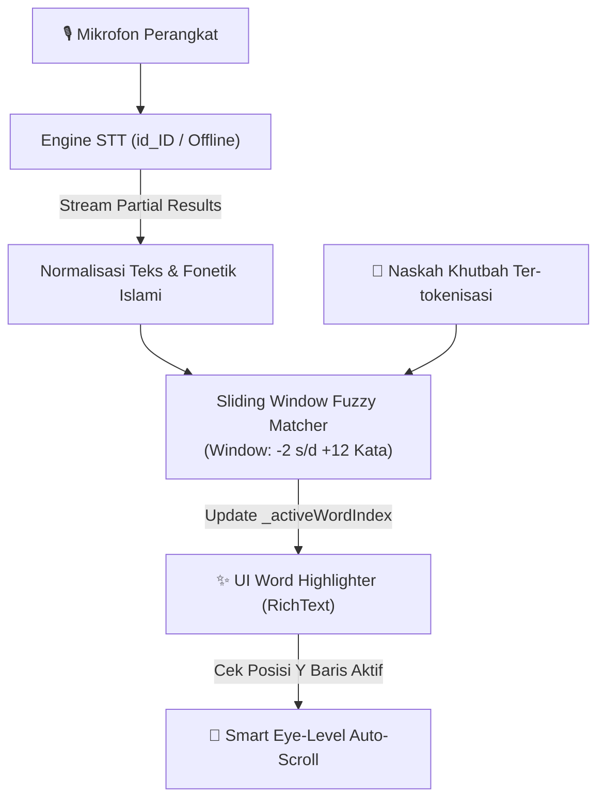

# Product Requirements Document (PRD): Smart Voice-Activated Teleprompter & Speech Alignment

| Informasi Dokumen | Detail |
| :--- | :--- |
| **Nama Fitur** | Smart Voice-Activated Teleprompter & Real-Time Speech Highlighter |
| **Aplikasi** | MimbarApp (NewMimbarApp) |
| **Versi Dokumen** | 1.0.0 |
| **Tanggal** | 13 November 2026 |
| **Status** | Draft / Ready for Implementation |
| **Target Modul** | `lib/features/khutbah/screens/teleprompter_screen.dart` & `practice_speech_screen.dart` |

---

## 1. Ringkasan Eksekutif (Executive Summary)
Fitur **Smart Voice-Activated Teleprompter** dirancang untuk membantu khatib, penceramah, dan da'i dalam menyampaikan khutbah atau pidato di atas mimbar tanpa harus mengatur kecepatan gulir (*scroll speed*) layar secara manual. 

Dengan menggabungkan teknologi **Real-Time Speech-to-Text (STT) Bahasa Indonesia (`id_ID`)** yang mendukung mode *offline* dan algoritma **Sliding Window Fuzzy Text Alignment**, aplikasi akan menyorot (*highlight*) kata demi kata yang sedang diucapkan khatib secara *real-time* (seperti efek karaoke) serta menggulirkan layar secara otomatis dan mulus (*eye-level auto-scroll*).

---

## 2. Latar Belakang Masalah (Problem Statement)
Saat ini, modul Teleprompter di MimbarApp ([teleprompter_screen.dart](file:///home/devkurniawan/Documents/Project/Muslim%20App/NewMimbarApp/lib/features/khutbah/screens/teleprompter_screen.dart)) dan Studio Latihan Suara ([practice_speech_screen.dart](file:///home/devkurniawan/Documents/Project/Muslim%20App/NewMimbarApp/lib/features/khutbah/screens/practice_speech_screen.dart)) masih memiliki beberapa keterbatasan saat digunakan di kondisi nyata di atas mimbar:

1. **Kecepatan Scroll Statis:** Teleprompter saat ini menggunakan `Timer` dengan kecepatan konstan (`px/detik`). Jika khatib berhenti sejenak untuk berdoa, menangis/terharu, menyapa jamaah, atau berimprovisasi, teks akan terus berjalan meninggalkan khatib.
2. **Kehilangan Fokus Baris Bacaan:** Saat khatib melihat ke arah jamaah lalu kembali menatap layar HP/tablet, khatib sering kesulitan menemukan kata terakhir yang baru saja diucapkan.
3. **Keterbatasan Sinyal di Dalam Masjid:** Banyak ruang utama masjid memiliki sinyal seluler yang lemah atau tidak stabil, sehingga fitur berbasis *cloud* murni berisiko gagal berfungsi di tengah khutbah.
4. **Metrik WPM Latihan Masih Simulasi:** Pada `PracticeSpeechScreen`, perhitungan *Words Per Minute* (WPM) saat ini masih menggunakan estimasi waktu statis, belum dihitung dari jumlah kata nyata yang diucapkan pengguna.

---

## 3. Tujuan & Sasaran Produk (Goals & Objectives)
* **Sinkronisasi Suara & Teks Real-Time:** Menyorot (*highlight*) kata yang sedang diucapkan dengan latensi visual $< 300\text{ ms}$.
* **Tahan Improvisasi & Kesalahan Dengar (Fault-Tolerant):** Tetap akurat meskipun terdapat gema mikrofon masjid (*reverb*), logat daerah, istilah serapan Arab-Indonesia, atau improvisasi singkat oleh khatib.
* **100% Berfungsi di Atas Mimbar (Offline-Capable):** Dapat berjalan tanpa koneksi internet dan tidak memunculkan gangguan visual/suara saat khatib mengambil jeda napas.
* **Mode Hybrid (Voice + Auto-Scroll + Remote):** Memungkinkan perpindahan mulus antara mode pengikut suara (*Voice-Sync*) dan mode gulir otomatis/manual jika mikrofon dimatikan.

---

## 4. Lingkup Fitur & Spesifikasi Fungsional (Functional Requirements)

### FR-01: Real-Time Word-by-Word Highlighter (Karaoke Text Tracking)
* Naskah khutbah dipecah menjadi token kata (`WordToken`) per bab/bagian.
* Teks ditampilkan dengan 3 status visual yang jelas:
  1. **Kata Terlewat (Spoken Words):** Warna teks diredupkan (*dimmed*) agar mata khatib fokus ke kata berikutnya.
  2. **Kata Aktif (Current Active Word):** Diberi sorotan latar belakang (*pill highlight* warna Emerald) dan ketebalan huruf (`FontWeight.w700`).
  3. **Kata Berikutnya (Upcoming Words):** Warna teks utama dengan kontras tinggi.
* Pengguna dapat mengetuk (*tap*) kata mana saja di layar untuk memindahkan posisi aktif (*anchor word*) secara manual kapan pun diperlukan.

### FR-02: Algoritma *Sliding Window Fuzzy Text Alignment*
Karena engine STT terkadang salah mengenali kata serapan Islami (misal: *"amanah"* terdengar *"amanat"*, *"shalawat"* terdengar *"selawat"*), sistem **tidak** menggunakan pencocokan teks eksak (*exact match*), melainkan:
* **Normalisasi Teks:** Menghapus tanda baca, mengubah ke huruf kecil (*lowercase*), dan menstandarkan ejaan serapan umum (misal: `sh` $\rightarrow$ `s`, `kh` $\rightarrow$ `k`, `dz` $\rightarrow$ `z`).
* **Sliding Window Lookahead:** Pencarian kata dibatasi pada jendela **12 kata ke depan** dan **2 kata ke belakang** dari posisi kata aktif saat ini (`_currentWordIndex`).
* **Fuzzy Phonetic & Levenshtein Similarity:** Menggunakan perhitungan jarak kemiripan karakter (*Levenshtein Similarity Ratio* $\ge 0.68$). Jika kata yang diucapkan memiliki kemiripan $\ge 68\%$ dengan kata di dalam *Sliding Window*, pointer langsung bergerak ke kata tersebut.
* **N-Gram Phrase Locking:** Mencocokkan kombinasi 2–3 kata berturut-turut dari *partial result* STT untuk mencegah lompatan kata yang salah jika ada kata hubung yang berulang (seperti *"dan"*, *"yang"*, *"di"*).

### FR-03: Smart Eye-Level Auto-Scroll
* Ketika posisi kata aktif (`_currentWordIndex`) bergerak turun mendekati batas tengah layar (zona baca ideal 35%–45% dari atas layar), `ScrollController` akan menggulir layar secara halus (`animateTo`) agar baris aktif selalu berada di sejajar pandangan mata khatib.
* Jika khatib berhenti berbicara atau berimprovisasi di luar naskah, layar akan **berhenti bergulir otomatis** dan menunggu hingga khatib kembali membaca kalimat yang ada di naskah.

### FR-04: Penanganan Bagian Teks Arab (Muqaddimah, Ayat, & Doa)
* Pada saat khatib membaca teks Arab, mode STT Bahasa Indonesia (`id_ID`) sering kali tidak mengenali kalimat Arab panjang, atau sebaliknya.
* **Solusi Terpadu:**
  1. Menyediakan kamus kunci fonetik untuk bacaan populer (seperti *Alhamdulillah*, *Assalamualaikum*, *Allahumma*, *Aamiin*) untuk memicu *highlight* pada blok Arab.
  2. Begitu khatib mulai mengucapkan kata pertama dari terjemahan/penjelasan Bahasa Indonesia di bawah teks Arab, fokus langsung berpindah tepat ke kata Indonesia tersebut.

### FR-05: Integrasi dengan Studio Latihan Suara (`PracticeSpeechScreen`)
* Mengganti simulasi WPM dengan **Real-Time Speech WPM** yang dihitung dari jumlah kata nyata yang berhasil diucapkan dibagi durasi bicara aktif:
  $$\text{Live WPM} = \frac{\text{Jumlah Kata Terverifikasi}}{\text{Waktu Bicara (Menit)}}$$
* Memberikan indikator kata yang terlewat (*skipped words*) atau bagian yang dibaca terlalu cepat pada rekapitulasi evaluasi.

---

## 5. Arsitektur Teknis & Pilihan Teknologi (Technical Architecture)

### 5.1. Diagram Alur Sistem (System Flow)

### 5.2. Strategi Dual-Engine STT (Modular Speech Service)
Sistem dirancang menggunakan *Abstraction Layer* (`SpeechAlignmentService`) agar mendukung dua tahap implementasi:

| Komponen | Fase 1: Native On-Device (`speech_to_text`) | Fase 2: Embedded Offline AI (`sherpa_onnx` / `vosk_flutter`) |
| :--- | :--- | :--- |
| **Cara Kerja** | Menggunakan engine pengenalan suara bawaan Android/iOS dengan `partialResults: true` dan `localeId: 'id_ID'`. | Menjalankan model neural ringan berbahasa Indonesia secara lokal di dalam aplikasi. |
| **Kebutuhan Internet** | **Bisa Offline** (menggunakan paket bahasa offline bawaan OS). | **100% Offline Mandiri** di semua perangkat tanpa pengaturan OS. |
| **Dampak Ukuran App** | **0 MB** (Tidak menambah ukuran APK/IPA). | **~35 MB** (Model diunduh saat fitur pertama kali diaktifkan). |
| **Penanganan Jeda Napas** | Menggunakan *Continuous Auto-Restart Listener* saat sesi OS *timeout*. | Streaming audio kontinu tanpa batas waktu dan tanpa bunyi *beep* OS. |

---

## 6. Desain Antarmuka & Pengalaman Pengguna (UI/UX Design)

1. **Tombol Toggle "Voice Sync" di Floating Toolbar:**
   * Menambahkan tombol mikrofon pintar (**Auto-Voice Sync ON/OFF**) di sebelah tombol *Play/Pause* pada [teleprompter_screen.dart](file:///home/devkurniawan/Documents/Project/Muslim%20App/NewMimbarApp/lib/features/khutbah/screens/teleprompter_screen.dart).
   * Saat **Voice Sync Aktif**: Indikator gelombang suara kecil (*live mic pulse*) muncul di header, dan kecepatan scroll sepenuhnya dikendalikan oleh suara khatib.
   * Saat **Voice Sync Nonaktif**: Kembali menggunakan mode *Timer Auto-Scroll* (`0.5x` – `6.0x`) seperti sebelumnya.
2. **Transisi Visual Halus:**
   * Perubahan *highlight* antar kata menggunakan kontras warna yang nyaman di mata baik pada **Mode Gelap (Mimbar Dark Mode)** maupun **Mode Terang**.
3. **Interaksi Sentuh Langsung (Tap-to-Jump):**
   * Jika khatib melompati satu paragraf penuh, khatib cukup mengetuk kata mana saja di paragraf baru, maka *Sliding Window* langsung berpindah ke titik tersebut.

---

## 7. Kebutuhan Non-Fungsional (Non-Functional Requirements)
* **Performa & Baterai:** Proses pencocokan *Sliding Window* hanya memeriksa maksimal 15 kata per *frame* suara (kompleksitas $O(W)$ di mana $W = 15$), sehingga penggunaan CPU $< 2\%$ dan layar tetap berjalan di **60 FPS** tanpa *frame drop*.
* **Privasi Audio:** Seluruh pemrosesan suara dilakukan secara *on-device* di memori sementara (RAM) tanpa menyimpan atau mengunggah rekaman khutbah ke server eksternal.
* **Ketahanan Layar (Wakelock):** Tetap terintegrasi dengan `wakelock_plus` agar layar tidak pernah redup atau terkunci selama mode Teleprompter aktif.

---

## 8. Tahapan Implementasi (Implementation Roadmap)

1. **Tahap 1 — Core Text Alignment Engine (`SpeechTextMatcher`):**
   * Membuat algoritma tokenisasi naskah, normalisasi fonetik Indonesia-Arab, dan *Sliding Window Levenshtein Matcher*.
2. **Tahap 2 — Integrasi STT Service (`VoiceTeleprompterController`):**
   * Mengintegrasikan package `speech_to_text` (`id_ID`, `partialResults: true`, auto-restart listener) dengan izin mikrofon (`permission_handler` yang sudah ada di `pubspec.yaml`).
3. **Tahap 3 — Upgrade UI `TeleprompterScreen` & `PracticeSpeechScreen`:**
   * Mengubah komponen teks statis menjadi *Interactive Word-by-Word Highlighter* (`RichText` dengan `TextSpan` interaktif) beserta fitur *Smart Eye-Level Auto-Scroll* dan perhitungan WPM asli.
4. **Tahap 4 — Ekspansi Embedded Offline Model (Opsional Lanjutan):**
   * Menambahkan opsi unduh model offline mandiri (`sherpa_onnx` / `vosk`) untuk perangkat yang tidak memiliki Google Speech Services offline.

